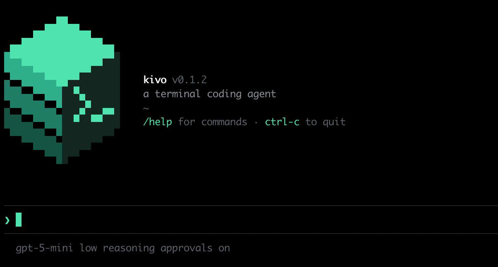

# Kivo

A terminal coding agent written in TypeScript, without an agent framework.

Kivo reads and edits files in your project, runs shell commands, and uses the results to decide what to do next. It shows you a diff and asks before every change.



```bash
kivo "the tests in test.js are failing, find and fix the bug"
```

## Installation

Kivo needs [Bun](https://bun.sh) 1.1 or later and an API key for OpenAI, Anthropic or DeepSeek.

```bash
npm install -g kivoforge
# or
bun install -g kivoforge
```

The npm package is `kivoforge`; the command it installs is `kivo`.

### From source

```bash
git clone https://github.com/govind-vashishat/Kivo.git
cd Kivo
bun install
bun link
```

### Standalone binary

```bash
bun run build
./kivo --help
```

This builds a single executable (about 100 MB) for your platform that runs without Bun installed.

## Configuration

Set the API key for the provider you want to use. You only need one:

```bash
export OPENAI_API_KEY="sk-..."      # openai/ models
export ANTHROPIC_API_KEY="sk-..."   # anthropic/ models
export DEEPSEEK_API_KEY="sk-..."    # deepseek/ models
```

Or put them in a `.env` file in the folder you run `kivo` from. Kivo checks at startup that the key for the chosen model is set.

| Variable            | Default          | Description                                                                             |
| ------------------- | ---------------- | --------------------------------------------------------------------------------------- |
| `OPENAI_API_KEY`    | none             | Needed for `openai/` models                                                             |
| `ANTHROPIC_API_KEY` | none             | Needed for `anthropic/` models                                                          |
| `DEEPSEEK_API_KEY`  | none             | Needed for `deepseek/` models                                                           |
| `KIVO_MODEL`        | `openai/gpt-6-luna` | Model as `provider/model`, e.g. `anthropic/claude-sonnet-5-5`. A bare name means OpenAI | A bare name means OpenAI |
| `KIVO_REASONING`    | provider default | `default`, `none`, `minimal`, `low`, `medium`, `high`, `xhigh` or `max`                 |                        |
| `DEBUG`             | off              | Set to `1` to show token usage for every step                                           |

Flags and session commands override these, see [Choosing a model](#choosing-a-model).

## Usage

```bash
kivo                           # start an interactive session
kivo "<task>"                  # run one task and exit
kivo --yes "<task>"            # run without asking for approval (also -y)
kivo -m deepseek/deepseek-chat # choose the model (also --model)
kivo -r low                    # choose the reasoning effort (also --reasoning)
kivo --help                    # show usage
```

Kivo works in the current directory. Run it from the root of the project you want it to work on.

### Choosing a model

Models are written as `provider/model`:

| Provider  | Example                       | Key                 |
| --------- | ----------------------------- | ------------------- |
| OpenAI    | `openai/gpt-5`                | `OPENAI_API_KEY`    |
| Anthropic | `anthropic/claude-sonnet-5-5` | `ANTHROPIC_API_KEY` |
| DeepSeek  | `deepseek/deepseek-chat`      | `DEEPSEEK_API_KEY`  |

The model and reasoning effort come from, in order: the `--model` / `--reasoning` flags, then `KIVO_MODEL` / `KIVO_REASONING`, then the defaults (`openai/gpt-6-luna`, the provider's own reasoning default).

In a session, `/model` on its own opens a list of models to pick from. Type to filter it, move with the arrow keys, press Enter to switch or Esc to cancel. Each row shows the model's context window and its price per million input and output tokens. The list comes from [models.dev](https://models.dev) and only includes models that can call tools, because Kivo needs them.

With an argument, `/model` switches straight away, and `/reasoning` sets the reasoning effort (on its own it shows the current one):

```
/model anthropic/claude-sonnet-5-5
/reasoning low
```

The conversation carries over when you switch, including to a different provider. If the new provider's key isn't set, Kivo stays on the current model and tells you which variable is missing. The status line under the input always shows what's active. A name that isn't on the models.dev list is still used, with a note, since the list can lag behind a new release; a real typo shows up as an error from the provider on your next prompt.

Each provider supports reasoning effort differently. DeepSeek, for example, only has low, high and max, so the levels in between are rounded to the nearest one.

### Approvals

Before Kivo writes or edits a file, it shows the diff and asks `y` / `n`. Before it runs a command, it shows the command and asks the same. If you say no, the model is told and asks what you want instead.

Commands that only read, such as `ls`, `cat`, `grep` or `git status`, run without asking. Anything that chains, redirects or could write still asks. `--yes` turns approvals off, for scripts and CI.

Shell commands run without a terminal: they get no input, most tools are told to skip their prompts, and a command is stopped after 5 minutes. A command can never hang Kivo waiting for an answer.

### Session commands

| Command              | Description                      |
| -------------------- | -------------------------------- |
| `/model [name]`      | Pick a model, or switch directly |
| `/reasoning [level]` | Show or set the reasoning effort |
| `/auto`              | Turn auto-approve on or off      |
| `/clear`             | Reset the conversation           |
| `/help`              | Show available commands          |
| `/exit`              | Quit                             |

In a session, the conversation carries over between prompts. A single-task run starts fresh.

## How it works

Kivo runs one loop:

1. Send the conversation and the tool definitions to the model.
2. If the response has no tool calls, the task is done.
3. Otherwise, run each tool call (asking first if it changes something), add the results to the conversation, and repeat.

```
user task ──▶ ┌──────────────────────────────┐
              │  model call (+ tool schemas) │◀────┐
              └──────────────┬───────────────┘     │
                             │                     │
                  any tool calls?                  │
                    │            │                 │
                   no           yes                │
                    │            │                 │
                   done    approve, run tools,     │
                           append results ─────────┘
```

The Vercel AI SDK is used only to call the model, which is what lets the same loop run on OpenAI, Anthropic and DeepSeek. The loop, tools, approvals and context are Kivo's own code.

### Error handling

Tool failures go back to the model as tool output instead of being thrown. A failed edit, a missing file or a non-zero exit code becomes part of the conversation, and the model adjusts on the next step.

### Context

The full conversation is kept in `ContextManager` and sent with every request, instead of relying on server-side conversation state. That keeps context handling, including the planned compaction, in Kivo's control.

### Tools

| Tool         | Description                                                                     |
| ------------ | ------------------------------------------------------------------------------- |
| `read_file`  | Read a file                                                                     |
| `write_file` | Create or overwrite a file                                                      |
| `edit_file`  | Replace an exact snippet; fails unless `old_text` matches exactly once          |
| `run_bash`   | Run a shell command in the project folder; returns stdout, stderr and exit code |

`edit_file` requires a unique match, so an ambiguous edit fails instead of landing in the wrong place.

### Events

The agent core in `src/agent/` imports nothing from the UI. It emits a typed event stream that the terminal UI and the eval runner each consume.

```ts
export type AgentEvent =
    | { type: "turn_start"; step: number }
    | { type: "text_delta"; text: string }
    | { type: "usage"; step: number; inputTokens: number; cachedInputTokens: number; outputTokens: number; reasoningTokens: number }
    | { type: "tool_start"; name: string; input: unknown; id: string }
    | { type: "tool_result"; id: string; output: string; isError: boolean }
    | { type: "turn_end"; stopReason: string }
    | { type: "error"; message: string }
    | { type: "thinking_start" }
    | { type: "thinking_end" };
```

## Project structure

```
src/
  agent/
    loop.ts        runAgent: the agent loop and system prompt
    models.ts      providers, their API keys, model and reasoning settings
    catalog.ts     model list from models.dev: context windows and prices
    tools.ts       tool definitions, executor, approval requests
    readonly.ts    which shell commands can run without asking
    context.ts     ContextManager: conversation state
    events.ts      AgentEvent types
  cli/
    index.ts       entry point and flags
    render.ts      error messages, debug event printer
    ui/            terminal UI built with Ink (React for the terminal)
      App.tsx      state, keyboard, agent events
      views.tsx    transcript items, tool lines, approval prompt, input
      ModelPicker.tsx  the /model list
      DiffView.tsx diffs with line numbers
      Banner.tsx   logo and header
      theme.ts     colours
bin/
  kivo.mjs         launcher used by the npm package
evals/
  runner.ts        evaluation harness
  sandboxes/       small projects with known bugs
```

## Evaluation

`evals/` holds small projects with known bugs. Each sandbox has a `task.json` (the prompt and a verification command) and a `test.js` that checks the fix.

```bash
bun run eval                                                  # every sandbox once
bun run eval 04 --runs 3                                      # sandboxes matching "04",three runs each
KIVO_MODEL=anthropic/claude-haiku-5-5 bun run eval --runs 5   # another model
```

Each sandbox is copied to a temporary folder and the agent runs on the copy. `test.js` is restored before verifying, so the agent can't pass by editing the test. Every run is recorded in `evals/eval_history.json` as pass, fail or error, with steps, input tokens (peak, total, cached, cache writes), output tokens, failed `edit_file` calls, cost, model, reasoning effort and git commit. Cost uses the model's prices from [models.dev](https://models.dev). A run that errors (the provider or the agent threw) is not verified and is left out of the pass rate and averages, but is still counted and costed. With `--runs`, the runner prints the mean and range per sandbox, because a single run of an agent is not a reliable number. Running the evals needs Node.js.

| Sandbox                  | Task                                                                          |
| ------------------------ | ----------------------------------------------------------------------------- |
| `01-syntax-error`        | Fix a file that doesn't parse                                                 |
| `02-failing-test`        | Fix an off-by-one error                                                       |
| `03-multi-file`          | Fix wrong prices across files                                                 |
| `04-invoice-currency`    | Trace a currency bug through a six-module invoicing system                    |
| `05-events-pipeline`     | Find why a five-stage metrics pipeline disagrees with finance's numbers       |
| `06-fulfillment-tickets` | Work through four tickets in an order fulfillment system without regressions |

### Results across models

Same Kivo commit (`8da6f25`), low reasoning, 5 runs of each sandbox per model. Each figure is for one run of all six sandboxes: the sum of each sandbox's mean.

| Model                        | Passed | Steps | Fresh input | Output | Failed edits | Cost   |
| ---------------------------- | ------ | ----- | ----------- | ------ | ------------ | ------ |
| `openai/gpt-6-luna`          | 29/29  | 42    | 39k         | 3.2k   | 0/65         | $0.008 |
| `deepseek/deepseek-flash`    | 30/30  | 35    | 46k         | 7.6k   | 0/58         | $0.012 |
| `anthropic/claude-haiku-5-5` | 30/30  | 28    | 66k         | 11.2k  | 0/71         | $0.017 |

Fresh input is input not read from the cache. Token counts can't be compared across providers (each has its own tokenizer, and Anthropic adds a hidden tool-use prompt), so cost is the number to compare. Fewer steps doesn't mean cheaper: Haiku takes the fewest steps but reads and writes the most per step. One gpt-6-luna run on `06` ended with a request timeout and isn't counted.

Before these results, the comparison found one difference: Haiku failed 12 of 88 `edit_file` calls by guessing an absolute path (`/root/src/...`). Describing file paths as relative to the project folder, in the tool schemas and the system prompt, brought that to 0 without changing the other models' results (#73).

## Roadmap

- **v0.2 Long tasks (done):** longer eval sandboxes, context compaction measured with and without (off by default)
- **v0.3 Any model:** model and reasoning from flags or `/model`, `/reasoning`; Anthropic and DeepSeek; the eval suite run on several models; a project instructions file
- **v0.4 Smoother terminal:** streaming output, Ctrl-C to interrupt a running task
- **v0.5 Knows your codebase:** a repo map, measured as fewer exploration steps
- **v0.6 Web UI:** a local server streaming the same events to a browser
- Later: image input, memory across sessions

## License

MIT